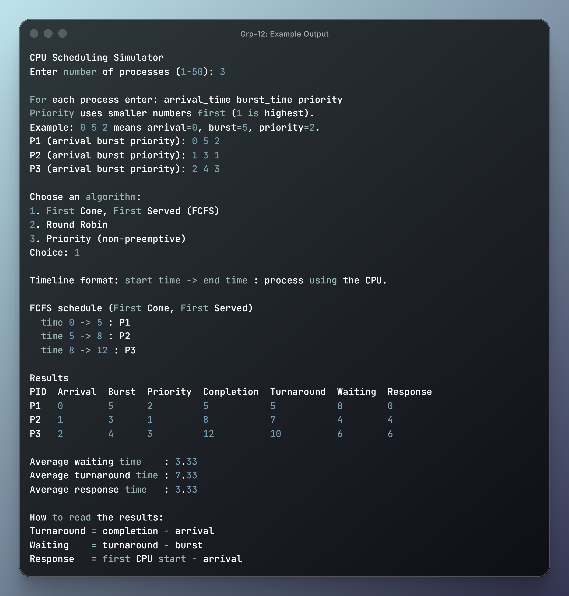

# Group - 12 : CPU Scheduling Simulator

## What is it?

A CPU scheduling simulator is a software tool that mimics how an operating system's kernel manages and allocates processor (CPU) time to competing processes. It allows users to visualize and analyze the behavior of different scheduling algorithms, such as First Come, First Served (FCFS), Round Robin (RR), and Priority Scheduling. By simulating these algorithms, users can observe how processes are selected for execution, how long they wait, and how efficiently the CPU is utilized.

The program implements concepts covered in Modules 1 and 2: C data types, variables, operators, conditions, loops, arrays, pointers, dynamic memory allocation, structures, functions, and circular queues.

## Design overview

The central design decision is to represent a process as a structure and the ready queue as a circular array of pointers to those structures. A pointer is placed in the queue instead of copying the entire process record. This connects the queue implementation with the structure-pointer concepts.

The processes are sorted by arrival time before simulation. The scheduler then repeatedly admits processes that have arrived, selects the next process according to the chosen policy, advances the simulated clock, and updates the process state. If no process is ready, the clock jumps to the next arrival time and the CPU is reported as idle.

The program currently implements three policies or algorithms:

- **FCFS(First Come, First Served):** removes processes from the front of the queue and runs each one until completion.
- **Round Robin:** removes the front process, runs it for a fixed time quantum, and places it at the rear if it still has remaining CPU time.
- **Priority scheduling:** examines the ready queue and selects the process with the smallest priority number. It is non-preemptive, so the selected process runs to completion.

These choices provide a progression from a basic FIFO queue to time-sliced scheduling and then to selection from a ready set.

## Main data structures

`Process` stores both input data and simulation state:

- `id`, `arrival`, `burst`, and `priority` describe the process.
- `remaining` records the uncompleted CPU time.
- `first_start` records the first time the process receives the CPU.
- `completion` records when the process finishes.

`Queue` implements a circular queue. `front` identifies the next item to remove, `rear` identifies the next insertion position, and `count` records the number of stored pointers. The code uses short names such as `p` for a process, `q` for a queue, `n` for a count, `t` for time, and `nx` for the next process. The expression

```c
(index + 1) % capacity
```

makes the array wrap around to its first position. This avoids shifting array elements after every dequeue.

## Important functions

### Queue functions

`initQ()` dynamically allocates the array of process pointers and initializes the queue indexes. `enQ()` inserts a pointer at the rear, while `deQ()` removes and returns the pointer at the front. `isEmpty()` supports the control flow of each scheduling algorithm, and `freeQ()` releases the queue memory.

These functions demonstrate structures passed by pointer, pointer-to-structure data, dynamic memory, and circular queue operations.

### Process preparation

`sortP()` uses a simple selection sort so that processes can be entered in any order while arrivals are processed correctly. `resetP()` initializes `remaining`, `first_start`, and `completion` before a simulation begins.

`addArr()` scans the sorted process array and enqueues every process whose arrival time is less than or equal to the current simulated time. The `nx` pointer parameter is updated by reference so that each process is admitted only once.

### `fcfs()`

FCFS is the most direct queue application. The function adds newly arrived processes to the ready queue, removes the process at the front, and runs it for its entire remaining burst. Since FCFS is non-preemptive, the process is not returned to the queue.

### `rr()`

Round Robin demonstrates preemption using a time quantum. After a process is dequeued, the function runs it for the smaller of its remaining time and the quantum. If work remains, the process is enqueued again. New arrivals are added before the interrupted process is re-enqueued, giving newly arrived processes their place in the ready queue.

### `pickPri()` and `pri()`

The priority implementation uses the circular queue as a ready set. `pickPri()` scans the current queue, identifies the process with the smallest priority value, removes that process, and preserves the order of the remaining entries. `pri()` then executes the selected process to completion.

This is a priority-queue style implementation rather than a separate heap or linked priority queue. It is appropriate for this project because it uses array traversal, comparisons, pointers, and queue operations already covered in the course material.

### `showRes()`

After scheduling, this function calculates and prints the standard metrics:

```text
turnaround time = completion time - arrival time
waiting time    = turnaround time - burst time
response time   = first start time - arrival time
```

The function uses structure fields, arithmetic expressions, loops, and call-by-reference-style updates through the process array. It also computes average values using `double` variables.

### `main()`

`main()` controls the input and execution flow. It validates the number of processes, dynamically allocates the process array, reads each process, asks the user to choose an algorithm, and reads a time quantum when Round Robin is selected. It then calls `sortP()` and `resetP()`, invokes the selected scheduling function, calls `showRes()`, and releases the allocated memory.

## Expected behavior

The output shows the execution timeline, including idle intervals, followed by a table of per-process results. Running the same input with different algorithms should produce different execution orders and metric averages.

- FCFS is simple but can make short processes wait behind a long process. 
- Round Robin distributes CPU time more fairly and usually improves early response for multiple ready processes, although a very small quantum produces many context switches in a real operating system. 
- Priority scheduling favors high-priority processes but can delay low-priority processes for a long time.

This simulator's purpose is to make queue behavior and scheduling metrics visible through a discrete-time model.

## Example Output

The following example shows the program input, Round Robin execution timeline, and calculated scheduling metrics.




## Sources

- [Source Code Inspiration](https://github.com/yousefkotp/CPU-Scheduling-Algorithms)
- [Creating a CPU Scheduling Simulator](https://www.scribd.com/document/977387928/raju-os)
- [CPU Scheduling in Operating Systems](https://www.geeksforgeeks.org/operating-systems/cpu-scheduling-in-operating-systems/)
